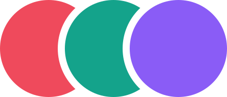

<p align="center">
  
</p>

<h1 align="center">ozero mail</h1>

<p align="center">A mail client for Android and iOS: one Rust core, a native UI on each platform.</p>

## Layout

```
core/    Rust core: domain → app → api
i18n/    UI strings: en.json (source), ru.json
tools/   CI checks
docs/    decisions (ADR)
```

## Build

Requires `rustup`; the Rust version is pinned in `rust-toolchain.toml`.

```sh
cd core && cargo test
```
